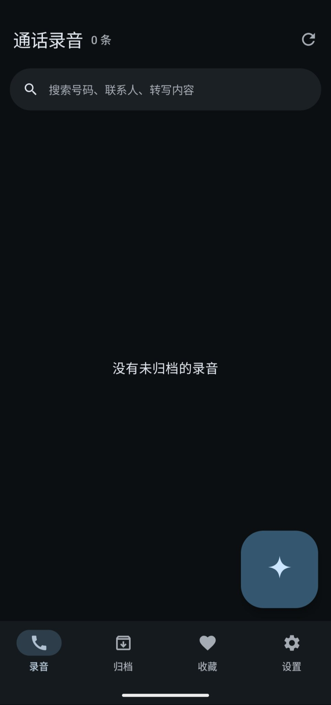
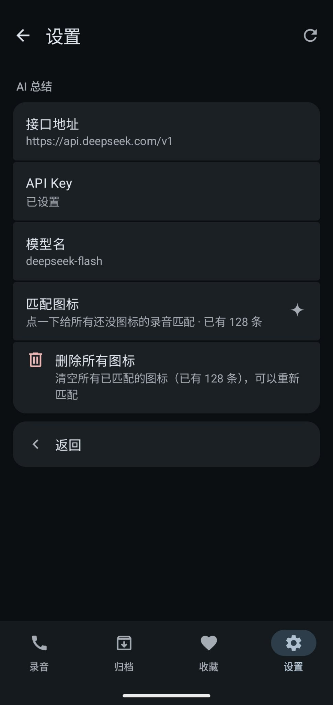

# 通话录音 · BCR Compose

用 Jetpack Compose + Material 3 Expressive 重写的 Android 通话录音管理器：读手机里的录音文件，**在本机转成文字**，再用你自己的大模型接口做总结、图标匹配和检索式对话。

An Android call-recording manager rewritten in Jetpack Compose & Material 3 Expressive. Recordings are transcribed **on-device** (sherpa-onnx + SenseVoice); summaries, icon tagging and Q&A go through **your own** OpenAI-compatible endpoint.

> 灵感来自 [nicorac/bcr-gui](https://github.com/nicorac/bcr-gui)（Ionic + Angular），但代码是重新写的：UI 全部是 Compose，数据层直接用 SAF 遍历录音目录。

> **不想自己编译？** 到 [Releases](../../releases) 页面下 debug 版 APK（arm64-v8a，debug 签名，装之前请卸载旧版）。

---

## 功能

**列表**
- 用系统目录选择器（SAF）指定录音文件夹，递归扫描，按 `日期_方向_号码` 解析文件名并匹配通讯录
- 分组卡片（`SegmentedListItem`）、时间分组、时长/大小、右侧拖动柄带时间气泡
- 左滑归档 / 右滑删除，88dp 触发，飞出动画 + 触感反馈
- 下拉刷新用官方 `pullToRefresh` 的 `LoadingIndicator`
- 长按多选 → 圆角矩形选中态 + 底部浮动工具条（全选、反选、分享、收藏、归档、删除）
- 搜索：官方 `SearchBar`，命中词用 `primaryContainer` 高亮，结果就是列表本身的样子

**播放**
- 播放页照 Gramophone 的手感：上下拖动跟手、松手吸附、两张白色圆角卡片（转写 / AI 总结）、波浪进度条、花瓣播放键（AVD）、倍速、收藏、分享
- 前后台播放由 `MediaSessionService` 提供，通知栏和锁屏都能控制

**转写与 AI**
- 端侧转写：sherpa-onnx + SenseVoice-Small（int8），模型首次使用时下载（约 239 MB），音频解码与重采样全在本地
- AI 总结：任何 OpenAI 兼容接口，总结不超过 200 字，要求不臆造
- AI 对话：把全部转写当语料提问，聊天记录本地保存
- AI 图标匹配：200 个 Material Symbols 组成的图标库（「学习作业 / 家人生活 / 朋友娱乐 / 出行购物 / 维修社区 / 钱与工作」六组），**转写完成后**由模型挑一个最贴切的，显示在列表左侧

**其他**
- 归档页、收藏夹、设置（外观 / 录音 / AI / 同步 / 关于）
- 文件夹同步：转写、AI 总结、归档与收藏、聊天记录写成 4 个 JSON 放进任意云端目录，换设备时合并（同一条留字数多的，收藏取并集）
- 手机上是底部导航栏，平板横屏自动变成左侧导航栏，播放页收成右侧栏

---

## 截图

| 列表 | 播放页 | AI 设置 | 平板 |
|---|---|---|---|
|  |  |  |  |

> 图片放在 `docs/screenshots/`，按上面的文件名放进去即可。

---

## 支持的录音

只做「读文件、播放、转写」，不接管通话，也不需要 root。

- 文件格式：`m4a` `mp3` `amr` `awb` `wav` `ogg` `opus` `flac` `aac` `mp4`
- 文件名格式：`yyyyMMdd_HHmmss[.SSS][+0800]_IN|OUT|CONFERENCE_号码`
  （`ShizukuCallRecorder`、`BCR-GUI` 等工具都是这个格式；不认识的文件名也能列出来并播放，只是没有方向和号码）

---

## 构建

| 项目 | 版本 |
|---|---|
| JDK | 17 |
| Gradle | 9.9.2（仓库自带 wrapper） |
| AGP | 9.5.2 |
| Kotlin | 2.2.21 |
| compileSdk / targetSdk | 37（预览，`compileSdkMinor = 1`） |
| minSdk | 31 |
| Compose / Material3 | 1.13.0 / 1.5.0 |
| Media3 | 1.11.1 |

需要装 **Android SDK Platform 37** 和 **Build-Tools 37.0.0**。ABI 只打 `arm64-v8a`（sherpa-onnx 的 AAR 太大）。

```bash
git clone https://github.com/oinanleo/bcr-gui-compose.git
cd bcr-gui-compose
bash scripts/fetch-deps.sh                 # 下载 sherpa-onnx 2.0.2 的 AAR 到 app/libs/
echo "sdk.dir=/path/to/Android/sdk" > local.properties
./gradlew :app:assembleDebug               # 产物 app/build/outputs/apk/debug/app-debug.apk
```

> `app/libs/*.aar` 不进版本库（50 MB），记得先跑 `scripts/fetch-deps.sh`。

---

## 第一次使用

1. 打开应用 →「选择目录」，选通话录音所在的文件夹
2. 允许读取通讯录，号码才会显示成联系人名
3. 想用 AI：设置 → AI 总结，填接口地址（如 `https://api.deepseek.com/v1`）、API Key、模型名；然后点「匹配图标」批量给**已经转写过**的录音配图标
4. 想转写：在播放页点「转写」，第一次会下载 239 MB 的模型；也可以在设置里打开「自动转写」，让它在后台慢慢转

---

## 数据与隐私

- **音频不出本机**：转写在本机跑，录音文件只读，从不修改或删除
- **AI 只发文字**：只有在总结、对话、图标匹配时，才把**转写文本**发给你自己配置的接口，不经过任何第三方服务器
- **没有统计和广告**：不接入任何埋点 SDK
- **本地存了这些**：`filesDir/state.json`（归档/收藏）、`transcripts.json`（转写）、`summaries.json`（AI 总结）、`chat.json`（对话）、`icons.json`（图标）、`durations.json`（时长）
- 「删除」只是从列表里隐藏，不会删手机里的文件

细节见 [PRIVACY.md](PRIVACY.md)。

---

## 已知限制

- 只构建 `arm64-v8a`
- 图标匹配依赖转写结果，没转写的录音左侧是空的白/蓝底圆
- 模型首次下载需要能访问 HuggingFace（失败会自动切 `hf-mirror.com`）
- 用的是预览版 SDK（37），需要较新的 Android Studio
- 没有做 BCR-GUI 的 `.bcr-gui-database.json` 兼容（只按文件名解析）

---

## 目录结构

```
app/src/main/java/com/leo/bcrgui/
├── MainActivity.kt      入口，edge-to-edge
├── Ui.kt                列表 / 底部栏 / 侧栏 / 搜索 / 设置 / 各页面
├── Player.kt            播放页（Gramophone 风格，AVD 花瓣播放键）
├── PlaybackService.kt   MediaSessionService + ExoPlayer
├── Saf.kt               SAF 递归扫描与文本读写
├── Names.kt             文件名解析、方向枚举
├── Contacts.kt          通讯录索引
├── Store.kt             本地 JSON 存储 + 文件夹同步合并
├── Asr.kt               sherpa-onnx 端侧转写（解码 / 重采样 / 分段）
├── Ai.kt                OpenAI 兼容接口：总结 / 对话 / 图标匹配
├── IconSet.kt           200 个图标的名字与中文含义
└── res/drawable/ic_ms_*.xml   Material Symbols 图标（vector）
```

想加图标：把一个 24dp 的 SVG 转成 vector drawable，命名 `ic_ms_<name>.xml` 放进 `res/drawable/`，再到 `IconSet.kt` 对应分组里加一行 `<name> to <中文含义>`。

---

## 致谢

- [nicorac/bcr-gui](https://github.com/nicorac/bcr-gui)：项目灵感与录音文件约定
- [Gramophone](https://github.com/FoedusProgramme/Gramophone)：播放页的视觉与手感
- [sherpa-onnx](https://github.com/k2-fsa/sherpa-onnx) + [SenseVoice](https://github.com/FunAudioLLM/SenseVoice)：端侧语音识别
- [AndroidX Media3](https://developer.android.com/media/media3)、[Jetpack Compose](https://developer.android.com/compose)、[Material Symbols](https://fonts.google.com/icons)

---

## 许可

[GPL-3.0](LICENSE)。随便用、随便改，改了也请开源。
